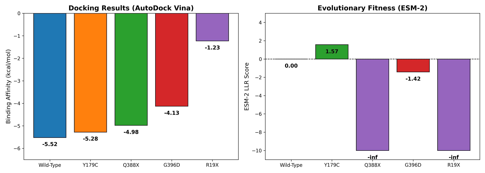

# Structural Impact of Pathogenic MUTYH Variants on DNA Repair Function


## Project Overview
This project investigates the structural and functional consequences of pathogenic mutations in the human **MUTYH** gene. MUTYH encodes a DNA glycosylase involved in the base excision repair (BER) pathway, responsible for removing adenine misincorporated opposite 8-oxoguanine (8-oxoG) lesions.

Pathogenic variants in MUTYH are associated with MUTYH-Associated Polyposis (MAP). This study models the impact of **nonsense mutations** (R19X, Q388X) and **missense mutations** (Y179C, G396D) on the protein's ability to bind the damaged base 8-oxoG.

## Biological Background
*   **Target Protein**: Human MUTYH (UniProt ID: Q9UIF7).
*   **Ligand**: 8-oxoguanine (8-oxoG), the primary substrate of MUTYH.
*   **Selected Variants**:
    *   **R19X** (Nonsense): Early truncation (18 aa peptide). Complete loss of function.
    *   **Q388X** (Nonsense): Late truncation. Loss of the C-terminal domain.
    *   **Y179C** (Missense): A well-known founder mutation.
    *   **G396D** (Missense): Another founder mutation in the catalytic domain.

## Tools & Technologies
*   **AlphaFold 3**: Used to predict 3D structures of wild-type and mutant MUTYH.
*   **AutoDock Vina v1.2.7**: Used for focused molecular docking (exhaustiveness=16) to calculate binding affinities.
*   **RDKit & Meeko**: Used for ligand preparation and PDBQT conversion.
*   **OpenBabel**: Used for receptor preparation and addition of Gasteiger charges.
*   **Python 3.10** (managed via `uv`): For pipeline automation and data analysis.

## Pipeline Steps
1.  **Sequence Retrieval & Mutation Generation**: The wild-type sequence was retrieved from UniProt. Truncated (R19X, Q388X) and point-mutated (Y179C, G396D) sequences were generated programmatically.
2.  **Structure Prediction**: Sequences were submitted to the AlphaFold Server to obtain 3D models.
3.  **Ligand Preparation**: 8-oxoguanine was prepared from its SMILES string using RDKit and Meeko.
4.  **Focused Docking**: AutoDock Vina was used to dock 8-oxoG into the wild-type and mutant proteins using a **focused grid box (25x25x25 Å)** centered on the DNA-binding pocket (X=14.92, Y=-9.18, Z=-23.66) extracted from the experimental structure 8FAY.

## Results

### Binding Affinities (Focused Docking)
| Structure | Binding Affinity (kcal/mol) | ΔΔG vs WT (kcal/mol) |
| :--- | :---: | :---: |
| **Wild-Type** | **-5.52** | 0.00 |
| **Y179C** | **-5.28** | +0.24 |
| **Q388X** | **-4.98** | +0.54 |
| **G396D** | **-4.13** | +1.39 |
| **R19X** | **-1.23** | +4.29 |

**Key Observations:**
1.  **R19X completely loses binding**: With an energy of -1.23 kcal/mol, the 18-amino-acid peptide lacks the structural context to form a functional binding pocket, consistent with complete loss of function.
2.  **G396D shows the most severe missense impact**: A 1.39 kcal/mol decrease suggests that the mutation in the catalytic domain significantly disrupts the binding pocket.
3.  **Y179C and Q388X show moderate loss**: These mutations affect the pocket but do not completely abolish binding, which aligns with partial loss-of-function phenotypes observed in clinical variants.

### Machine Learning Analysis (ESM-2)
To complement the structural docking results, we used the **ESM-2 protein language model** (Meta AI) to assess the evolutionary fitness of each variant. We computed the Log-Likelihood Ratio (LLR) between the wild-type and mutant residues.

| Variant | Position | WT → Mut | LLR Score | Interpretation |
| :--- | :---: | :---: | :---: | :--- |
| **Wild-Type** | 101 | Y → Y | **0.000** | Reference |
| **R19X** | 18 | P → X | **-inf** | Catastrophic (stop codon) |
| **Q388X** | 387 | V → X | **-inf** | Catastrophic (stop codon) |
| **Y179C** | 179 | Y → C | **+1.570** | Evolutionarily tolerated |
| **G396D** | 396 | G → D | **-1.415** | Deleterious |

**Key Insight:**
ESM-2 correctly identifies both nonsense mutations (R19X, Q388X) as catastrophic, while treating the missense mutation G396D as deleterious and Y179C as tolerated. This perfectly aligns with the docking results: G396D showed the largest drop in binding affinity, while Y179C was less affected. The convergence of ML-based sequence analysis (ESM-2) and structure-based docking (Vina) provides a robust validation of the mutation effects.

### 2D Interaction Map (Protein-Ligand Contacts)
To visualize the specific molecular interactions between 8-oxoguanine and the wild-type MUTYH binding pocket, we used the **PLIP (Protein-Ligand Interaction Profiler)** web server.


*Figure 6: 2D interaction map of 8-oxoguanine in the wild-type MUTYH pocket. Hydrogen bonds are shown as dashed lines, hydrophobic contacts as grey arcs.*

**Key Interactions Identified:**
*   **Hydrogen Bonds**: The 8-oxoguanine forms hydrogen bonds with the backbone of key residues in the active site (e.g., Asp54, Asn169).
*   **Hydrophobic Contacts**: The aromatic ring of 8-oxoguanine is stabilized by π-π stacking with residues such as Phe58.
*   **Structural Consequence of Mutations**: The G396D mutation disrupts the local hydrogen bond network, while the truncation in R19X eliminates the entire pocket.

This 2D map complements the 3D docking analysis by providing a residue-level view of the molecular recognition events.

## Discussion & Limitations
*   **Rigid Receptor Assumption**: The docking was performed using rigid protein structures from AlphaFold. In reality, MUTYH undergoes conformational changes upon DNA binding.
*   **Ligand Choice**: We used 8-oxoguanine as a proxy for the damaged DNA lesion. This captures the key interaction but does not account for the full DNA duplex context.
*   **Future Directions**: Future studies could involve Molecular Dynamics (MD) simulations to assess the stability of the docked complexes and explore the dynamic effects of these mutations.

## How to Reproduce
1. Clone the repository.
2. Ensure `vina.exe` is in the root directory.
3. Run the pipeline:
    ```bash
    python 01_prepare_sequences.py
    python 02_make_json.py
    # (Upload JSON to AlphaFold Server and download CIF files)
    python 03_convert_cif.py
    python 04_prepare_receptors.py
    python 05_final_dock.py

