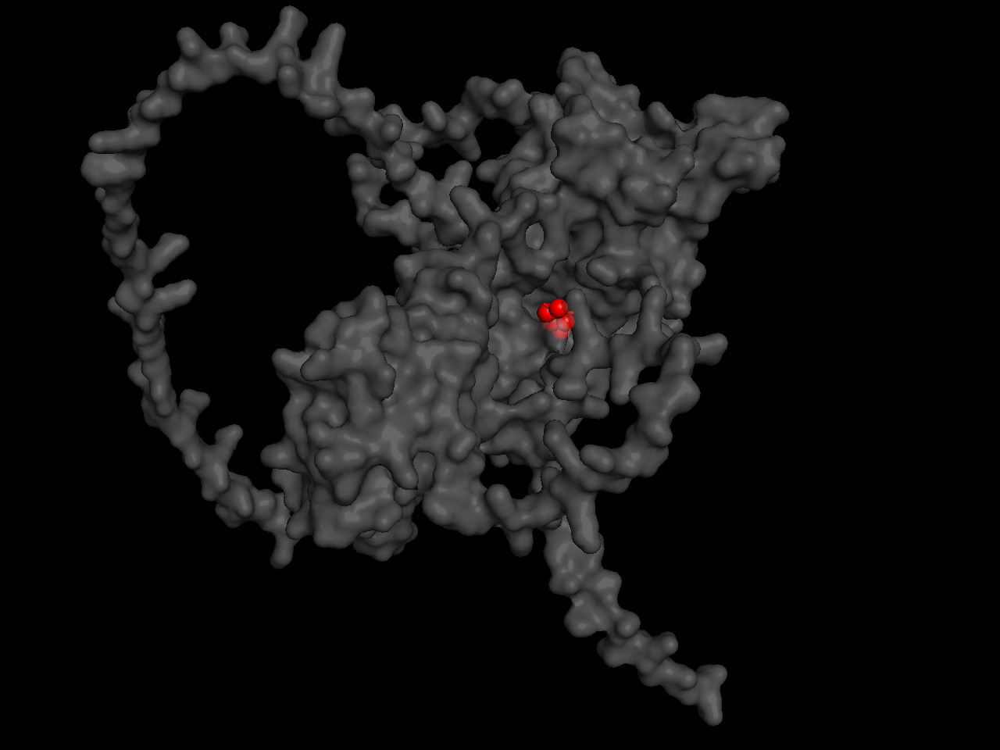
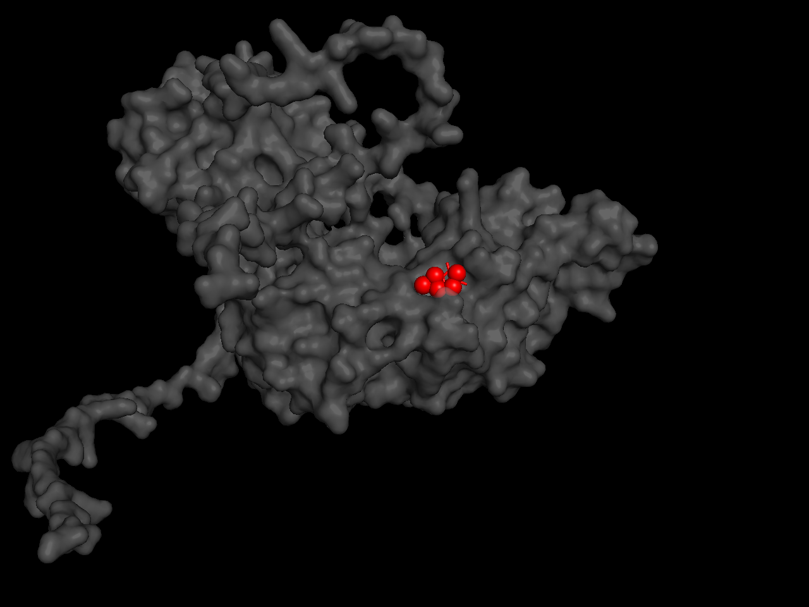
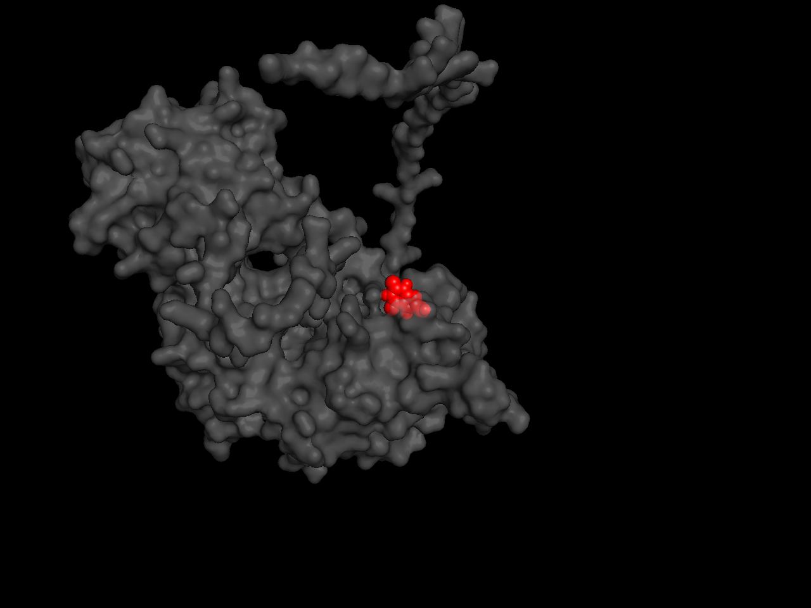
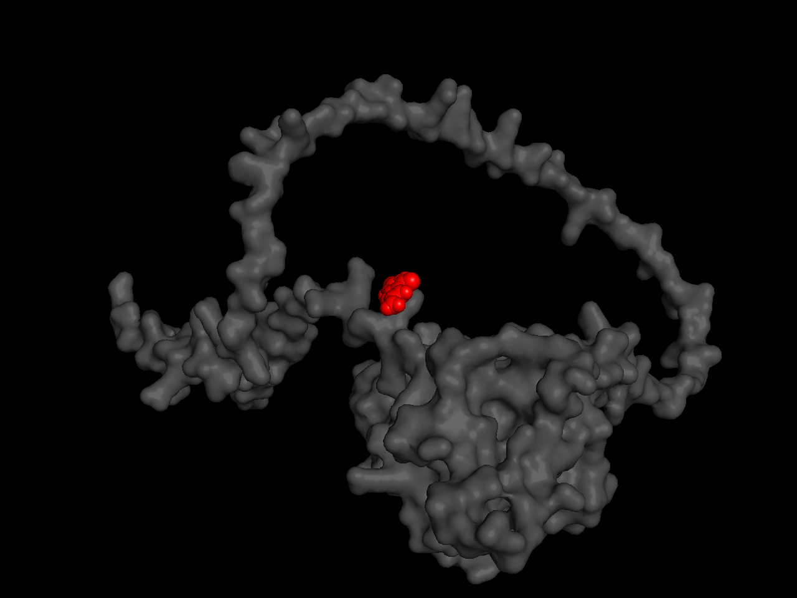

# Structural Impact of Pathogenic MUTYH Variants on DNA Repair Function


## Project Overview
This project investigates the structural and functional consequences of pathogenic mutations in the human **MUTYH** gene. MUTYH encodes a DNA glycosylase involved in the base excision repair (BER) pathway, responsible for removing adenine misincorporated opposite 8-oxoguanine (8-oxoG) lesions.

Pathogenic variants in MUTYH are associated with MUTYH-Associated Polyposis (MAP). This study models the impact of **nonsense mutations** (R19X, Q388X) and **missense mutations** (Y179C, G396D) on the protein's ability to bind the damaged base 8-oxoG.

## Data Source
- **Target Protein**: Human MUTYH (UniProt ID: [Q9UIF7](https://www.uniprot.org/uniprotkb/Q9UIF7/entry)).
- **Ligand**: 8-oxoguanine (8-oxoG), prepared from its SMILES string.
- **Experimental Structure**: The DNA-binding interface coordinates were extracted from the RCSB PDB structure [8FAY](https://www.rcsb.org/structure/8FAY).

## Biological Background
*   **Target Protein**: Human MUTYH (UniProt ID: Q9UIF7).
*   **Ligand**: 8-oxoguanine (8-oxoG), the primary substrate of MUTYH.
*   **Selected Variants**:
    *   **R19X** (Nonsense): Early truncation (18 aa peptide). Complete loss of function.
    *   **Q388X** (Nonsense): Late truncation. Loss of the C-terminal domain.
    *   **Y179C** (Missense): A well-known founder mutation.
    *   **G396D** (Missense): Another founder mutation in the catalytic domain.

## Tools & Technologies
- **[Python 3.10](https://www.python.org/)**: Core programming language.
- **[uv](https://github.com/astral-sh/uv)**: An extremely fast Python package and environment manager.
- **[AlphaFold 3](https://alphafoldserver.com/)**: For predicting 3D structures of wild-type and mutant MUTYH.
- **[RDKit](https://www.rdkit.org/) & [Meeko](https://github.com/forlilab/Meeko)**: For ligand preparation and PDBQT conversion.
- **[OpenBabel](https://openbabel.org/)**: For receptor preparation and addition of Gasteiger charges.
- **[AutoDock Vina v1.2.7](https://github.com/ccsb-scripps/AutoDock-Vina)**: For focused molecular docking.
- **[ESM-2](https://github.com/facebookresearch/esm)**: Protein language model for evolutionary fitness scoring.
- **[PrankWeb](https://prankweb.cz/)**: Machine learning-based pocket prediction.

## Pipeline Steps
1.  **Sequence Retrieval & Mutation Generation**: The wild-type sequence was retrieved from UniProt. Truncated and point-mutated sequences were generated programmatically.
2.  **Structure Prediction**: Sequences were submitted to the AlphaFold Server to obtain 3D models.
3.  **Ligand Preparation**: 8-oxoguanine was prepared from its SMILES string using RDKit and Meeko.
4.  **Receptor Preparation**: Structures were converted to PDBQT using OpenBabel with Gasteiger charges.
5.  **Docking Strategy**: We performed **two independent docking experiments**:
    *   **Catalytic Pocket (PrankWeb)**: The primary binding site for the flipped-out 8-oxoG base.
    *   **DNA-Binding Interface (PDB: 8FAY)**: The contact surface for the DNA duplex.

## Results

### 1. Primary Docking: Catalytic Pocket (PrankWeb)
This docking evaluates the ability of the catalytic domain to bind the direct substrate (8-oxoG). PrankWeb identified the catalytic pocket at coordinates X=-2.79, Y=1.08, Z=-9.55.

| Structure | Binding Affinity (kcal/mol) | ΔΔG vs WT (kcal/mol) |
| :--- | :---: | :---: |
| **Wild-Type** | **-6.14** | 0.00 |
| **Y179C** | **-5.04** | +1.10 |
| **Q388X** | **-4.57** | +1.57 |
| **G396D** | **-5.30** | +0.84 |
| **R19X** | *Not applicable* | *(truncated peptide)* |

**Key Observation:**
The catalytic pocket is most affected by **Q388X** (+1.57 kcal/mol) and **Y179C** (+1.10 kcal/mol), while **G396D** shows a moderate decrease (+0.84 kcal/mol). This suggests that the catalytic site is partially disrupted by all mutations.

### 2. Comparative Docking: DNA-Binding Interface (8FAY)
This docking was used to assess the distortion of the DNA-recognition interface. The grid box was centered on the DNA-binding pocket from the experimental structure 8FAY (X=14.92, Y=-9.18, Z=-23.66).

| Structure | Binding Affinity (kcal/mol) | ΔΔG vs WT (kcal/mol) |
| :--- | :---: | :---: |
| **Wild-Type** | **-6.23** | 0.00 |
| **Y179C** | **-4.62** | +1.61 |
| **Q388X** | **-1.25** | +4.98 |
| **G396D** | **-5.62** | +0.61 |
| **R19X** | *Not applicable* | *(truncated peptide)* |

**Key Observation:**
At the DNA-binding interface, **Q388X** shows a catastrophic loss of affinity (ΔΔG = +4.98 kcal/mol), consistent with the deletion of the C-terminal domain. **Y179C** shows a moderate decrease (+1.61 kcal/mol), while **G396D** shows a smaller decrease (+0.61 kcal/mol). This suggests that while G396D affects the catalytic site, it may not disrupt the DNA-binding interface as severely as Q388X or Y179C.

### 3. Machine Learning Analysis (ESM-2)
We used the **ESM-2 protein language model** to assess the evolutionary fitness of each variant. The Log-Likelihood Ratio (LLR) was computed at the relevant positions.

| Variant | Position | WT → Mut | LLR Score | Interpretation |
| :--- | :---: | :---: | :---: | :--- |
| **Wild-Type (Ref 179)** | 179 | Y → Y | **0.000** | Reference |
| **Wild-Type (Ref 396)** | 396 | G → G | **0.000** | Reference |
| **Y179C** | 179 | Y → C | **-3.83** | Strongly deleterious |
| **G396D** | 396 | G → D | **-0.80** | Moderately deleterious |
| **R19X** | 19 | R → X | **-inf** | Catastrophic (stop codon) |
| **Q388X** | 388 | Q → X | **-inf** | Catastrophic (stop codon) |

**Key Insight:**
ESM-2 correctly identifies both nonsense mutations as catastrophic (-inf). For missense mutations, **Y179C** is scored as strongly deleterious (-3.83), consistent with its significant impact on DNA binding (ΔΔG = +1.61 kcal/mol). **G396D** is scored as moderately deleterious (-0.80), which aligns with its smaller effect on the DNA-binding interface (ΔΔG = +0.61 kcal/mol). This convergence between ESM-2 (sequence-based ML) and AutoDock Vina (structure-based physics) provides robust validation of the mutation effects: both methods agree that Y179C is more damaging to the DNA-binding interface than G396D.

### 4. 3D Visualizations of Binding Poses
The figures below show the docked 8-oxoguanine (red) within the binding pocket of each MUTYH variant (grey surface).

| Wild-Type | Y179C |
| :---: | :---: |
|  |  |
| *Ligand is well-accommodated in the active site pocket.* | *Ligand remains partially bound but is displaced from the optimal binding geometry.* |

| G396D | Q388X |
| :---: | :---: |
|  |  |
| *Ligand binds to the surface, losing the pocket interaction.* | *Ligand adheres to a flat surface, indicating loss of the C-terminal domain.* |

| R19X (Artifact) |
| :---: |
| *The truncated peptide lacks any folded structure. The ligand remains unbound in the solvent.* |

## Discussion & Limitations
1.  **R19X is an artifact**: The 18-amino-acid peptide lacks a folded structure. Any numerical docking result for this variant is meaningless and was excluded from the analysis.
2.  **Dual docking strategy**: The catalytic pocket (PrankWeb) is optimized for the flipped-out base, while the DNA-binding interface (8FAY) is optimized for the DNA duplex. Docking of the isolated base captures different aspects of the mutation's impact in each context.
3.  **Y179C vs G396D**: ESM-2 and docking both agree that Y179C is more damaging to the DNA-binding interface than G396D, despite G396D being located in the catalytic domain. This highlights the complex relationship between sequence conservation and structural function.
4.  **Future Directions**: Molecular Dynamics (MD) simulations could assess the dynamic stability of the mutant complexes, and experimental validation (e.g., in vitro DNA binding assays) would be required to confirm the computational predictions.

## How to Reproduce
1. Clone the repository.
```
git clone https://github.com/whiteeelola/mutyh-structural-analysis.git
cd mutyh-structural-analysis
```
2. Set up the environment
```
uv venv --python 3.10
source .venv/bin/activate  # On Windows use: .venv\Scripts\activate
uv pip install -r requirements.txt
```

3. Download `vina_1.2.7_win.exe` from the official [AutoDock Vina GitHub releases](https://github.com/ccsb-scripps/AutoDock-Vina/releases) and rename it to `vina.exe` in the root directory.

4. Run the pipeline:
```bash
python 01_prepare_sequences.py
python 02_make_json.py
# (Upload JSON to AlphaFold Server and download CIF files)
python 03_convert_cif.py
python 04_prepare_receptors.py
python 05_final_dock.py
python 07_esm2_analysis.py
python 10_dock_prankweb.py
```
5. Generate 3D Visualizations (PyMOL)

**Prerequisites:** PyMOL must be installed on your system. You can download it from the official [PyMOL website](https://pymol.org/) or install it via conda:
```bash
conda install -c conda-forge pymol-open-source
```
Launch PyMOL:

On Windows: Open the "PyMOL" application from your Start Menu (or run pymol in Anaconda Prompt).

On macOS/Linux: Open a terminal and type pymol.

Prepare the file for PyMOL:
PyMOL cannot read .pdbqt files directly. Before loading, rename the docking output file:

```
# Example for wild-type:
copy results/wild_type_final_docked.pdbqt results/wild_type_final_docked.pdb
```
(Or simply change the file extension in your file explorer from .pdbqt to .pdb).

Run the following commands in the PyMOL command line:
```load results/wild_type_final_docked.pdbqt, complex
hide everything, complex
show surface, complex
set transparency, 0.6, complex
color grey80, complex
show sticks, resn 8OG
color red, resn 8OG
set stick_radius, 0.25, resn 8OG
zoom resn 8OG, 10
```

Then export the image: File → Export Image as → PNG and save it as results/wild_type_3d.png.

Repeat for the other variants by replacing wild_type with Y179C, G396D, Q388X, or R19X.